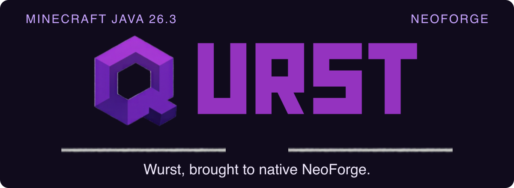

<p align="center">
  
</p>

# Qurst

**Wurst Client, brought to native NeoForge with a purple identity.** Qurst is Qu4rk's development port of Wurst 7.56 for **Minecraft Java 26.3**, **NeoForge 26.3.0.51-beta** and **Java 25**.

[Build it](#build-and-play) · [Port roadmap](docs/NEOFORGE_PORT.md) · [Source inventory](docs/upstream-inventory.json) · [Report a bug](https://github.com/Qu4rk/Qurst/issues)

## What works today

| Verified slice | Evidence |
| :--- | :--- |
| Native bootstrap | Client reaches the title screen; all 156 hacks, 52 commands and 18 other features register. |
| Translations and Options | Bundled German translations, the Options toggle and saved language preferences survive restart. |
| Keybinds and profiles | Editing, capture, profile save/load and restored keyboard/mouse dispatch pass native client checks. |

**The full port is in progress.** All upstream feature sources are retained; these checks establish the behavior above. Movement, rendering, combat, world/inventory features and optional renderer compatibility still need their own runtime verification. This is a development build, with no stable Qurst release yet.

## Build and play

Install a **Java 25 JDK**, set `JAVA_HOME`, then:

```sh
./gradlew build --console=plain
python3 scripts/verify_neoforge_port.py
./gradlew runClient --console=plain
```

The game runs in `run/`. For an existing Minecraft **26.3** installation with the target NeoForge version, place the development jar in its `mods/` directory:

```text
build/libs/Qurst-7.56-MC26.3-NeoForge-dev.1.jar
```

The corresponding `-sources.jar` is built alongside it. Install only the main jar. Use a fresh game directory while testing the port. On the development Mac, `./scripts/gradle-java25` selects the existing Java 25 installation and can replace `./gradlew`.

Qurst's default ClickGUI palette pairs dark violet panels with purple accents and pale lavender text. Your supplied Qurst logo appears in the HUD and Options button. Existing custom colors remain saved. The internal mod ID and data directory remain `wurst` so the rename preserves configuration compatibility.

## Verify the port

These native client checks need a graphical session and exit automatically:

```sh
./gradlew runClientSmoke --console=plain
./gradlew runClientTranslationsTest --console=plain
./gradlew runClientKeybindsTest --console=plain
```

They use isolated directories under `run/`; translations and keybinds each test two launches to prove restart persistence. Test mods are excluded from the production jar. The package verifier checks native metadata, retained feature classes/assets, GPL notices and corresponding sources, and rejects Fabric dependencies. GitHub Actions runs the build and package checks.

The [roadmap](docs/NEOFORGE_PORT.md) tracks the remaining slices. Original Fabric tests are preserved as migration references and do not count as native NeoForge evidence. Development launches use the upstream analytics debug path.

## Upstream and license

Qurst derives from [Wurst Client 7.56](https://github.com/Wurst-Imperium/Wurst7/tree/71e3af0f2747937086ef889e34359507d95cc9f8), pinned to commit `71e3af0f2747937086ef889e34359507d95cc9f8`.

Original code © 2014–2026 Wurst-Imperium and contributors. Qurst port and branding maintained by Qu4rk and contributors. The upstream **GPLv3** license and **GPL-3.0-or-later** metadata are preserved; see [LICENSE.txt](LICENSE.txt). Original assets and copyright notices remain in the source distribution.

[Original Wurst README](docs/UPSTREAM_README.md) · [Wurst feature documentation](https://wurst.wiki/)
